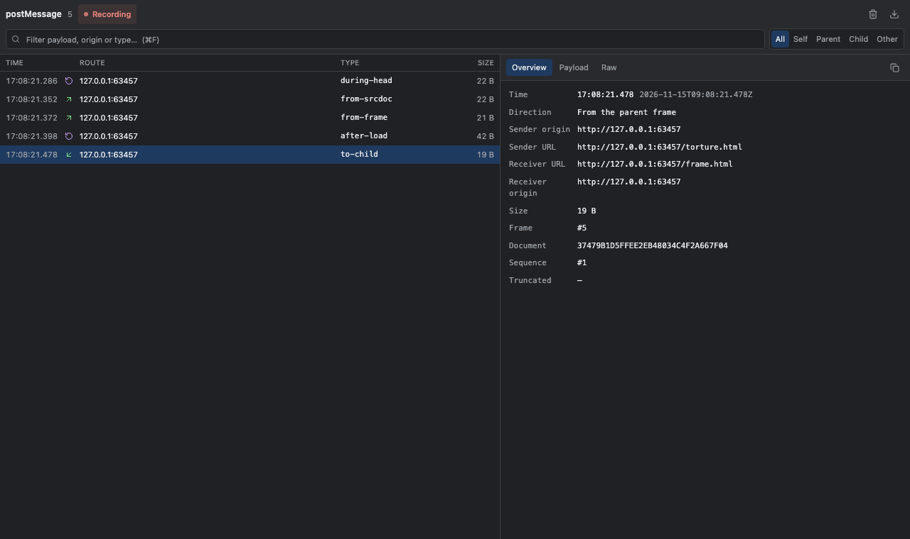

# postMessage-catcher

Capture, inspect and audit `postMessage` traffic between windows, iframes and
workers — in a proper DevTools panel, not in a flooded console.



_Light theme variant: [panel-light.png](docs/screenshots/panel-light.png)._

## Why v3

v2 wrote captured messages to the page console with `console.log`. It ran at
`document_idle`, only in the top frame, and re-injected a script tag into the
page. That missed messages sent during page load, everything received inside
iframes, and every page whose CSP blocked the injected script.

v3 is a rewrite around three rules:

1. **Observe, never modify.** The probe never wraps `window.postMessage`. Doing so
   rewrites `event.source` to the receiving window and breaks pages that validate
   the sender. Capture is receive-only, in every frame.
2. **Be early.** `document_start`, `all_frames`, `match_origin_as_fallback` and
   the MAIN world, so `about:blank`, `srcdoc`, `data:` and `blob:` frames are
   covered before any page script runs.
3. **Never break the page.** Bounded snapshots, `try/catch` everywhere, and no
   page object is mutated.

## Features

- **DevTools panel** with a virtualised list and a detail pane
  (Overview / Payload / Raw).
- **Sender attribution**: self, parent, top, child or other — plus the accurate
  `event.origin`, even cross-origin.
- **Search and filters**: free-text search across payload, origin and type, plus
  per-direction chips; `⌘F`/`Ctrl+F`, `↑`/`↓`, `Esc`.
- **Payload inspector** that handles what JSON cannot: cycles, `Map`, `Set`,
  `BigInt`, `Date`, `Error`, typed arrays, `MessagePort`, DOM nodes, throwing
  getters. Truncation is reported, never silent.
- **History that survives reloads** — the service worker keeps a per-tab ring
  buffer, so you can open the panel _after_ the bug.
- **Per-tab recording** plus a master switch; scrolling up stops the list from
  following new messages, so reading never fights the live stream.
- **Popup theme switch**: System / Light / Dark, remembered across sessions.
- **Export** the filtered list as JSON.
- **Local only**: no network, no telemetry, no remote code.

## Known limitations

- `targetOrigin` is not shown: it is only visible on the sending side, and
  patching the sending side is exactly what breaks pages.
- The sender's `frameId` is not knowable cross-origin; the panel shows origin +
  relationship.
- `MessagePort`, `BroadcastChannel` and `Worker` traffic is not captured yet.
- Frames that do not execute scripts (`sandbox` without `allow-scripts`) cannot
  be probed.
- `chrome://`, extension pages and the Chrome Web Store cannot run content
  scripts.

## Install

### From source (v3)

```bash
pnpm install
pnpm build
```

Then open `chrome://extensions`, enable **Developer mode**, choose
**Load unpacked** and select `.output/chrome-mv3`.

### Chrome Web Store

The published build is the v2 extension:
<https://chromewebstore.google.com/detail/postmessage-catcher/henlmhlhpgnkeecjjcbhhcfmecohnilo>.
v3 is not submitted yet.

## Development

Requires Node 22+ and pnpm 12.

```bash
pnpm dev          # WXT dev server
pnpm build        # production build → .output/chrome-mv3
pnpm compile      # tsc --noEmit
pnpm lint         # ESLint
pnpm test         # Vitest
pnpm test:probe   # run the built MAIN-world probe without a browser
pnpm test:e2e     # real browser end-to-end (set CHROME_BIN to Chrome for Testing)
pnpm check        # everything above + build
```

Open DevTools → **postMessage** to use the panel. The popup is only for switching
recording and checking the count.

## Project layout

| Path                            | Role                                                   |
| ------------------------------- | ------------------------------------------------------ |
| `entrypoints/probe.content.ts`  | MAIN-world observer (no `chrome.*`)                    |
| `entrypoints/bridge.content.ts` | ISOLATED-world state + batching                        |
| `entrypoints/background.ts`     | Router, ring buffer, badge                             |
| `entrypoints/devtools/`         | DevTools panel registration                            |
| `entrypoints/panel/`            | Panel UI (React)                                       |
| `entrypoints/popup/`            | Popup UI (React)                                       |
| `lib/`                          | Protocol, snapshot, attribution, buffers — unit tested |
| `docs/architecture.md`          | How it works, with diagrams                            |
| `legacy/`                       | The v2 implementation, for reference                   |

## Privacy

Everything is processed locally. See [docs/privacy.md](docs/privacy.md).

## Contributing

Issues and pull requests are welcome. Before opening a PR:

1. Run `pnpm check`.
2. Add a Vitest test for pure logic in `lib/`.
3. Read [`AGENTS.md`](AGENTS.md) — it lists the invariants that keep the
   extension from breaking the pages it inspects.

## Credits

Inspired by [postMessage-logger](https://github.com/opnsec/postMessage-logger).
Thanks to [chrome-plugin-demo](https://github.com/sxei/chrome-plugin-demo) and
[youtube-translator](https://github.com/bugushi/youtube-translator) for early
reference material.

## License

MIT — see [LICENSE](LICENSE).
