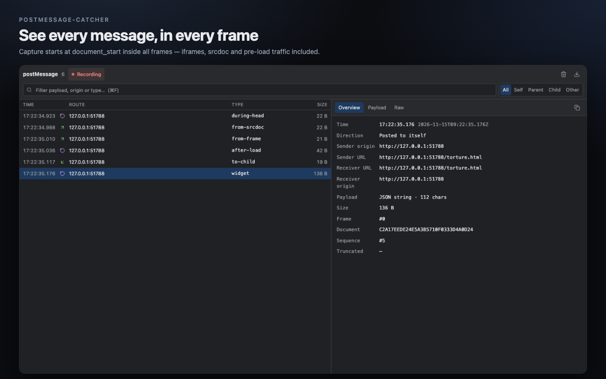
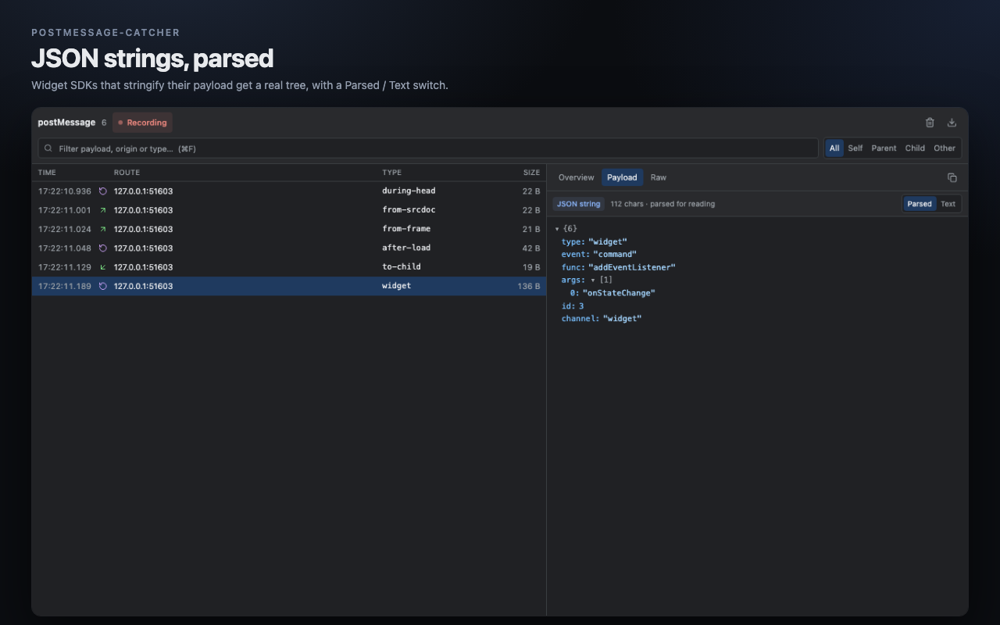
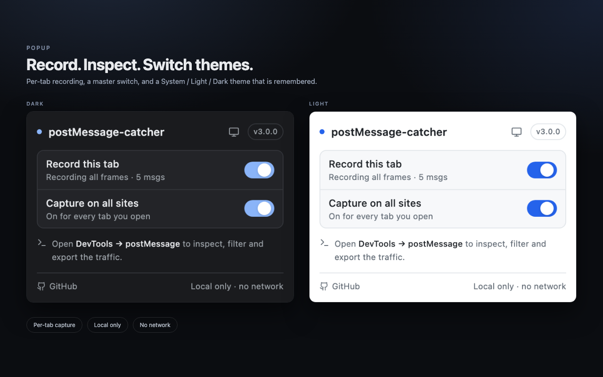

# postMessage-catcher

Capture, inspect and audit `window.postMessage` traffic — in a DevTools panel, on
every frame, without changing how the page behaves.



## Why this exists

Reading postMessage by pasting `console.log` into a page fails in three ways: it
sees one frame, it starts too late, and it floods the console. v3 is a rewrite
around three rules:

1. **Observe, never modify.** The probe never wraps `window.postMessage`.
   Replacing it rewrites `event.source` to the receiving window, which breaks
   pages that validate the sender. Capture is receive-only.
2. **Be early.** `document_start` + `all_frames` + `match_origin_as_fallback` +
   the MAIN world, so `about:blank`, `srcdoc`, `data:` and `blob:` frames are
   covered before any page script runs.
3. **Never break the page.** Bounded snapshots, a `try/catch` on every capture
   path, and no page object is mutated.

## Features

- **DevTools panel** with a virtualised list and Overview / Payload / Raw detail,
  sender attribution, search, direction filters, keyboard navigation and JSON
  export.
- **Every frame, from the start**: iframes, `srcdoc`, `about:blank` and messages
  sent during page load are captured.
- **Trusted attribution**: `event.origin` plus self / parent / child / other,
  even for cross-origin senders.
- **JSON strings, parsed**: payloads that were `JSON.stringify`-ed open as a tree
  with a Parsed / Text switch; the list shows the inner discriminator.
- **History across reloads**: the worker keeps a per-tab ring buffer and persists
  a compact copy to `storage.session`, so you can open the panel after the bug.
- **Recording controls**: per-tab recording plus a master switch.
- **Popup theme switch**: System / Light / Dark, remembered across sessions.
- **Local only**: no network, no telemetry, no remote code.

## Screenshots



JSON-encoded payloads open as a tree, with a Parsed / Text switch.



Per-tab recording, a master switch, and a System / Light / Dark theme.

## Install

### From source (v3)

```bash
pnpm install
pnpm build
```

Open `chrome://extensions`, enable **Developer mode**, choose **Load unpacked**
and select `.output/chrome-mv3`.

### Chrome Web Store

The published listing is the v2 build:
<https://chromewebstore.google.com/detail/postmessage-catcher/henlmhlhpgnkeecjjcbhhcfmecohnilo>.
v3 is not submitted yet.

## Usage

1. Open any regular `http(s)` page and DevTools → **postMessage**.
2. Interact with the page, or reload it to catch the load-time traffic.
3. Select a message to inspect routing, payload and warnings.
4. `⌘F` / `Ctrl+F` filters; `↑` / `↓` moves the selection; `⌘C`-style copy and
   **Export** are in the toolbar.
5. The popup switches recording per tab and globally.

## Limitations

- `targetOrigin` is not shown: it is only visible on the sending side, and
  patching the sending side is the thing that breaks pages.
- The sender's `frameId` is not knowable cross-origin; the panel shows origin and
  relationship.
- `MessagePort`, `BroadcastChannel` and `Worker` traffic is not captured yet.
- Frames that do not execute scripts (`sandbox` without `allow-scripts`) cannot
  be probed.
- `chrome://`, extension pages and the Chrome Web Store cannot run content
  scripts.
- The panel follows the DevTools theme; the popup theme switch is separate.

## Development

Requires Node 22+ and pnpm 12.

```bash
pnpm dev          # WXT dev server
pnpm build        # production build → .output/chrome-mv3
pnpm compile      # tsc --noEmit
pnpm lint         # ESLint
pnpm test         # Vitest, including release-docs checks
pnpm test:probe   # execute the built MAIN-world probe without a browser
pnpm test:e2e     # real browser (set CHROME_BIN to Chrome for Testing)
pnpm check        # compile + lint + test + build + probe smoke test
pnpm zip          # .output/postmessage-catcher-<version>-chrome.zip
pnpm store:assets # compose store images (set CHROME_BIN)
pnpm changelog --minor   # bump version + prepend CHANGELOG.md
```

Branded Chrome no longer honours `--load-extension`, so the browser checks need
Chrome for Testing or Chromium.

## Project layout

| Path                                          | Role                                                          |
| --------------------------------------------- | ------------------------------------------------------------- |
| `entrypoints/probe.content.ts`                | MAIN-world observer (no `chrome.*`)                           |
| `entrypoints/bridge.content.ts`               | ISOLATED-world state + batching                               |
| `entrypoints/background.ts`                   | Router, ring buffer, badge                                    |
| `entrypoints/devtools/`, `entrypoints/panel/` | DevTools panel                                                |
| `entrypoints/popup/`                          | Toolbar popup                                                 |
| `lib/`                                        | Protocol, snapshot, attribution, theme, buffers — unit tested |
| `scripts/store/`                              | Store asset composer and frames                               |
| `docs/`                                       | Architecture, privacy, release process, research notes        |
| `store/`                                      | Chrome Web Store copy and exact-size assets                   |
| `.agents/`                                    | Skills and notes for coding agents                            |
| `legacy/`                                     | The v2 implementation, for reference                          |

## Privacy

Everything is processed locally. See [docs/privacy.md](docs/privacy.md).

## Docs

- [Architecture](docs/architecture.md) — how capture, routing and the panel work.
- [Release process](docs/release-process.md) — changelog, store assets, zip, tag.
- [Research notes](docs/architecture-research.md) — the November 2026 groundwork.
- [Changelog](CHANGELOG.md).

## Contributing

Issues and pull requests are welcome. Before opening a PR:

1. Run `pnpm check` (and `pnpm test:e2e` for runtime changes).
2. Add a Vitest test for pure logic in `lib/`.
3. Read [`AGENTS.md`](AGENTS.md) — it lists the invariants that keep the
   extension from breaking the pages it inspects.

## Credits

Inspired by [postMessage-logger](https://github.com/opnsec/postMessage-logger).
Thanks to [chrome-plugin-demo](https://github.com/sxei/chrome-plugin-demo) and
[youtube-translator](https://github.com/bugushi/youtube-translator) for early
reference material.

## License

MIT — see [LICENSE](LICENSE).
