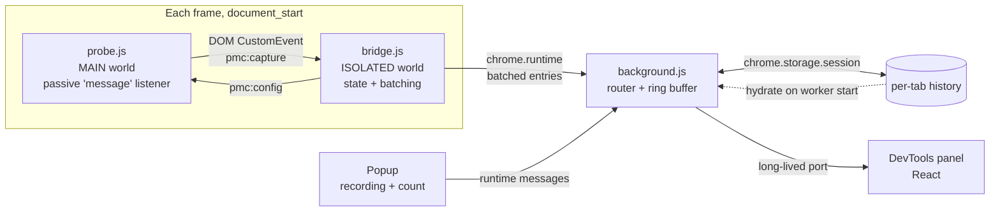
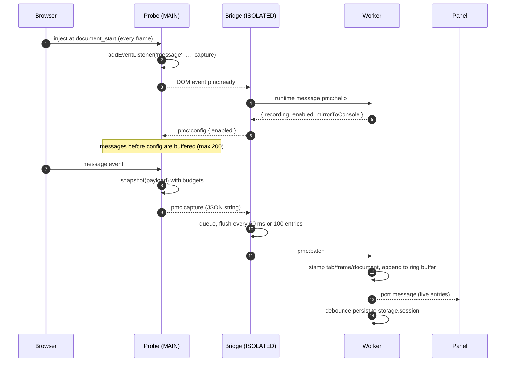

# Architecture

<!-- release: 3.0.0 -->

This document describes how postMessage-catcher works at runtime and how the
codebase is organised. Diagrams are Mermaid and render on GitHub.

- Applies to: **v3.0.0**
- Source of truth: `entrypoints/`, `lib/`, `components/`, `wxt.config.ts`
- Related: [Privacy](privacy.md) · [Release process](release-process.md) · [Research notes](architecture-research.md)

---

## 1. What it does

The extension observes `window.postMessage` traffic in every frame of a page and
shows it in a DevTools panel: a list of messages, a payload inspector, sender
attribution, filters, and an export.

Non-goals: modifying page behaviour, intercepting network traffic, auditing
WebSocket frames, or replacing the browser's Network panel.

---

## 2. Runtime topology



| Context | Entry point                     | Lifetime                   | Responsibility                                              |
| ------- | ------------------------------- | -------------------------- | ----------------------------------------------------------- |
| Probe   | `entrypoints/probe.content.ts`  | Page lifetime, every frame | Observe deliveries, snapshot payloads, attribute sender     |
| Bridge  | `entrypoints/bridge.content.ts` | Page lifetime, every frame | Resolve recording state, batch entries, flush on `pagehide` |
| Worker  | `entrypoints/background.ts`     | MV3 lifecycle              | Stamp entries, ring buffer, fan-out, badge                  |
| Panel   | `entrypoints/panel/`            | While DevTools is open     | List + detail + filters + export                            |
| Popup   | `entrypoints/popup/`            | While open                 | Per-tab and master switches, count                          |

`wxt.config.ts` generates two declarative content-script entries: the bridge in
the default ISOLATED world and the probe with `"world": "MAIN"`. Both use
`document_start`, `all_frames: true` and `match_origin_as_fallback: true`, so
iframes — including `about:blank`, `srcdoc`, `data:` and `blob:` frames — are
covered before any page script runs.

### Why receive-only

The intuitive design wraps `window.postMessage` to also see sends and their
`targetOrigin`. It is wrong, and it is measurable. `event.source` is derived from
the realm of the code that called `postMessage`. A wrapper installed in the
receiving window makes the browser report the _receiver_ as the sender:

```
wrap=false  sourceIsParentSelf=false  sourceIsChild=true
wrap=true   sourceIsParentSelf=true   sourceIsChild=false
```

(Headless Chrome 157: a `srcdoc` child posts to its parent, with and without a
pass-through wrapper on the parent's `window.postMessage`.)

Any page that validates `event.source === iframe.contentWindow` breaks. So the
probe only ever listens: every message is eventually delivered as a `message`
event in some window, and with a probe in every frame we see all deliveries.

The cost is explicit: we cannot show `targetOrigin`, and we cannot see sends
that were dropped because the target origin did not match. We do not pretend
otherwise.

Note also that `Window.prototype.postMessage` is `undefined` — the method lives
on the global object itself — so the common `Window.prototype.postMessage = …`
hook silently patches nothing.

---

## 3. Capture pipeline



Design points:

- **Nothing is lost before configuration.** The probe buffers up to 200 raw
  events until the bridge has read storage, then flushes them. If recording is
  off, the buffer is dropped.
- **Fail closed.** If configuration never arrives, the probe never captures.
  There is no "capture anyway" fallback.
- **Batching.** The bridge coalesces entries so a message-heavy page does not
  turn into one `sendMessage` per message. The queue is bounded at 2,000.
- **Never throw.** `snapshot()` handles cycles, `BigInt`, functions, DOM nodes,
  throwing getters and depth/length budgets. A hostile payload cannot disable
  the probe.

### Payload budgets

| Budget        | Default | Behaviour                        |
| ------------- | ------- | -------------------------------- |
| Depth         | 6       | `{ "$pmc": "MaxDepth" }`         |
| Object keys   | 100     | extra keys counted as truncated  |
| Array items   | 100     | extra items counted as truncated |
| String length | 10,000  | sliced with `…`                  |
| Nodes         | 2,000   | `{ "$pmc": "Truncated" }`        |
| Whole payload | 512 KB  | `{ "$pmc": "Oversize", bytes }`  |

Values JSON cannot represent are marked, never dropped silently: `$pmc` is one
of `Function`, `BigInt`, `Symbol`, `Undefined`, `Number` (NaN/Infinity), `Node`,
`Window`, `Map`, `Set`, `Date`, `RegExp`, `Error`, `ArrayBuffer`,
`TypedArray`, `MessagePort`, `Circular`, `MaxDepth`, `Truncated`, `Unreadable`,
`Oversize`, `TrimmedForStorage`.

---

## 4. Recording state

Three layers, each with a clear meaning:

| Layer             | Stored in                                | Scope         | Effect                                    |
| ----------------- | ---------------------------------------- | ------------- | ----------------------------------------- |
| Master switch     | `storage.local` → `pmc:settings.enabled` | Whole profile | Off means the probe never captures        |
| Per-tab recording | `storage.session` → `pmc:recording`      | One tab       | Off stops that tab without losing history |

Effective recording is `settings.enabled && (recording[tabId] ?? true)`.

The bridge learns its state from `pmc:hello` and keeps it in sync through
`chrome.storage.onChanged` (session for per-tab, local for master) plus a direct
`pmc:recording` push from the worker. That redundancy is deliberate: a content
script must not depend on a single notification path.

---

## 5. Data model

`lib/protocol.ts` is the single source of truth.

```jsonc
{
  "v": 1,
  "id": "12-1a", // unique within the buffer
  "seq": 42, // per-document sequence
  "ts": 1763200000123,
  "tabId": 12,
  "frameId": 3, // receiver frame
  "documentId": "…", // groups messages by navigation
  "documentLifecycle": "active",
  "channel": "window",
  "receiver": { "url": "https://shop.test/checkout", "origin": "https://shop.test" },
  "sender": { "kind": "child", "origin": "https://pay.test", "url": "https://pay.test/frame" },
  "data": { "type": "auth:ready" },
  "size": 812,
  "truncated": { "depth": 0, "keys": 0, "items": 0, "strings": 0, "nodes": 0 },
}
```

`sender.kind` is one of `self`, `parent`, `top`, `child`, `other`, `unknown`. It
is derived by comparing `event.source` with `window`, `window.parent`,
`window.top` and each iframe's `contentWindow`. Window-proxy identity works
across origins, but the sender's `frameId` is not knowable, so the UI shows the
relationship and the origin — not a fake frame id.

---

## 6. Storage and buffering

| Key             | Area      | Contents                                                           |
| --------------- | --------- | ------------------------------------------------------------------ |
| `pmc:settings`  | `local`   | `{ enabled, mirrorToConsole, maxEntriesPerTab }`                   |
| `pmc:recording` | `session` | `{ [tabId]: boolean }`                                             |
| `pmc:buffers`   | `session` | Last 300 entries per tab, payloads over 24 KB replaced by a marker |

- The worker keeps the live ring buffer in memory (`maxEntriesPerTab`, default
  2,000) and persists a compact subset on a 400 ms debounce.
- `storage.session` has a 10 MB quota; the compact projection keeps it bounded.
- `setAccessLevel('TRUSTED_AND_UNTRUSTED_CONTEXTS')` lets content scripts read the
  per-tab flag. If that call fails on an older Chrome, the direct push path still
  works.
- History deliberately survives page reloads and worker suspension: that is the
  feature that lets you open the panel _after_ the bug.

---

## 7. Failure modes

| Failure                            | Handling                                                       |
| ---------------------------------- | -------------------------------------------------------------- |
| Probe runs before bridge           | Buffers, flushes when `pmc:config` arrives                     |
| Bridge runs before probe           | Sends `pmc:config`; probe also asks via `pmc:ready`            |
| Worker suspended                   | `sendMessage` wakes it; buffer rehydrates from session storage |
| Panel closed                       | Worker keeps buffering; badge still updates                    |
| Storage quota                      | Persist is best effort; in-memory buffer stays authoritative   |
| Page payload throws while reading  | Marked `Unreadable`; capture continues                         |
| Page replaces `JSON`/`CustomEvent` | Natives are captured at `document_start`                       |
| Tab closed                         | Buffer and per-tab flag removed; badge cleared                 |
| Recording toggled mid-page         | Session change + direct push both re-configure the probe       |

---

## 8. UI

The panel follows the DevTools theme through `chrome.devtools.panels.themeName`
and `onThemeChanged`. The list is virtualised (26 px rows) so a full 2,000-row
buffer stays responsive.

- **Toolbar** — a labelled **Recording** pill (red dot; the only control that
  stops capture), the count, and clear/export on the top row; search and sender
  filter chips on the second row. There is no separate "freeze view" mode: the
  list stops following the newest row as soon as you scroll away or select a
  message.
- **List** — time, direction icon, `sender → receiver`, inferred type, size.
  Rows with opaque origins are flagged.
- **Detail** — Overview (routing, sizes, warnings), Payload (lazy tree), Raw.
  The active tab belongs to the panel, not the message, so it survives selecting
  another message: scan payload after payload with one click each.
- **Keyboard** — `⌘F`/`Ctrl+F` search, `↑`/`↓` move selection, `Esc` clear.
- **Popup** — one settings card with the per-tab and master switches (the
  per-tab switch disables itself when the master switch is off), the buffer
  count inline in the state line, and a one-line DevTools hint. 320 px wide.
  A **System / Light / Dark** switch sits in the header; the choice is stored in
  `pmc:theme` and mirrored to `localStorage` so the popup paints the right theme
  before React starts. It affects the popup only — the panel follows the
  DevTools theme.

Captured values are rendered as text nodes only. No `innerHTML`, no `eval`.

---

## 9. Known limitations

- No `targetOrigin` (see [Why receive-only](#why-receive-only)).
- Sender frame ids are approximate; attribution is origin + relationship.
- Frames without script execution (`sandbox` without `allow-scripts`) are
  invisible.
- `chrome://`, extension pages and the Chrome Web Store cannot be probed.
- `MessagePort`, `BroadcastChannel` and `Worker` traffic is not captured yet;
  `channel` exists in the protocol for that work.
- The master switch cannot unregister the declarative content scripts; it gates
  capture instead.

---

## 10. Build and release

```bash
pnpm dev       # WXT dev server
pnpm build     # .output/chrome-mv3
pnpm check     # compile + lint + test + build + probe smoke test
pnpm test:e2e  # real browser; needs CHROME_BIN (Chrome for Testing)
pnpm zip       # .output/postmessage-catcher-<version>-chrome.zip
```

`scripts/smoke-probe.mjs` executes the **built** probe bundle against a fake
window. It asserts that the bundle never references `chrome.*`, that early
messages are buffered and flushed, and that cycles, `BigInt` and throwing getters
do not break capture.

`scripts/e2e.mjs` loads the built extension in Chrome for Testing over the
DevTools protocol and asserts the behaviour unit tests cannot see: the probe is
injected at `document_start`, messages sent in `<head>` are captured, `srcdoc`
frames inherit the parent origin, a parent → child delivery is observed by the
child's probe, and the panel bundle boots. Branded Chrome no longer honours
`--load-extension`, so this needs Chrome for Testing or Chromium via `CHROME_BIN`.

The manifest version comes from `package.json`; never edit the built manifest.
See [Release process](release-process.md).
